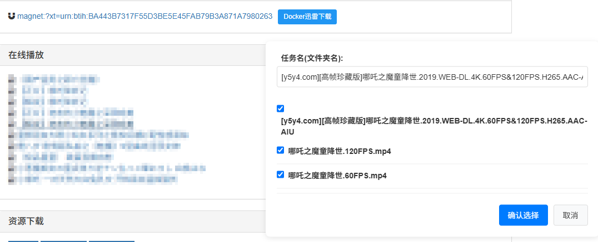

# 迅雷下载助手 Chrome扩展

[](LICENSE)
[](https://github.com/saaak/xunlei-docker-ext/releases)

简体中文 | [English](README_EN.md)

简化迅雷下载服务的交互体验，支持**迅雷官方远程通道**与**本地直连（Docker/飞牛OS）**双模式，在网页上一键解析磁力链接并提交下载任务。



## ✨ 功能特性

- 🌐 **迅雷远程通道 (推荐)** - 登录迅雷账号后，直接将下载任务云端推送至名下绑定的任意远程设备（NAS/Docker迅雷/下载宝）：
  - **无需公网 IP / 内网穿透**：出差、在公司或咖啡厅均可远程一键推送到家中 NAS。
  - **不占每日限额**：走官方远程任务通道，官方口径不占套件端每日配额。
  - **多设备支持**：账号下多台设备可在扩展中自由切换。
  - **内置风控短信验证**：首次登录触发安全验证时可在扩展中直接完成短信校验。
- 🐳 **本地引擎直连** - 支持局域网内直接连接 Docker 迅雷（[cnk3x/xunlei](https://github.com/cnk3x/xunlei)）或飞牛 OS 原生迅雷（默认 5666 端口）。
- 📁 **默认下载目录配置** - 支持预设默认下载子目录（如 `/movies/` 或 `/folder/`），下载时自动应用为目录前缀，无需每次在任务名中手动前缀输入。
- 🔗 **网页磁力链接一键捕获** - 自动检测网页中的 magnet 链接并注入下载按钮，弹出对话框提供独立的下载子目录与任务名输入，支持快速选择要下载的子文件。
- 📊 **统一任务面板** - 实时展示当前进行中（下载速度、进度百分比）与已完成的任务。
- 🔔 **下载完成通知** - 任务下载完成时自动发送 Chrome 系统桌面通知。

## 📦 安装

### 开发者模式安装

1. 克隆或下载本仓库：
   ```bash
   git clone https://github.com/saaak/xunlei-docker-ext.git
   ```

2. 打开 Chrome 浏览器，访问：`chrome://extensions/`
3. 开启右上角的 **"开发者模式"**。
4. 点击 **"加载已解压的扩展程序"**，选择本项目目录即可。

## 🚀 使用指南

### 方式一：迅雷远程通道 (推荐)
1. 点击扩展图标打开面板，选择 **"迅雷远程 (推荐)"** 模式。
2. 输入您的迅雷账号（手机号/邮箱/迅雷号）和密码，点击 **"登录并绑定设备"**。
   > 若触发风控验证，扩展会自动弹出短信验证框，点击“获取验证码”并输入 6 位短信码即可完成授权。
3. 登录成功后，在下拉列表中选择你的 **下载目标设备**（如你的 NAS）。
4. 点击 **"保存并进入任务面板"** 即可开始使用。

### 方式二：本地直连模式
1. 切换到 **"本地直连"** 标签。
2. **选择平台**：
   - **Docker**：适用于标准 Docker 部署（默认端口 2345）。
   - **飞牛原生**：适用于飞牛 OS 原生套件，默认端口 5666。
3. 输入局域网主机 IP 地址（Host）及默认文件类型（可选）。
4. 点击 **"保存配置"**。

### 添加下载任务
1. 浏览含有磁力链接的网页，点击链接旁注入的 **"Docker迅雷下载"** 按钮。
2. 在弹出的文件列表中自定义任务名称、勾选需要的文件后点击 **"确认选择"**。
3. 任务将自动派发到选定的设备中开始下载。

## 👥 贡献与致谢

- [maglcal/fnmedia-dl](https://github.com/maglcal/fnmedia-dl) - 感谢提供宝贵的迅雷云端远程协议与风控验证参考。
- [cnk3x/xunlei](https://github.com/cnk3x/xunlei) - Docker迅雷服务。

## 📜 许可证

本项目采用 [MIT License](LICENSE)。
